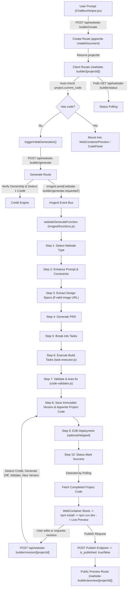

# 01 — Architecture Map & Component Inventory

## 1. Complete Route & Component Inventory

### UI Entry Points & Composer
- **`app/_components/ChatBoxAiInput.jsx`**:
  - Handles chat composer input and model selection.
  - Detects website creation intent or mode selection.
  - Line 954: Calls `POST /api/website-builder/create` with `{ prompt: combinedQuery, userEmail }`.
  - Dispatches `historyUpdated` event and routes to `/website-builder/${data.projectId}`.
- **`app/_components/ComposerPlusMenu.jsx`**:
  - Flyout menu providing studio/tool modes.
- **`app/_components/AppSidebar.jsx`**:
  - Library and history list. Renders website projects with `icon: Globe` and routes to `/website-builder/${item.libId}`.
- **`app/_components/modals/SearchChatModal.jsx`**:
  - Search and filter by project type `website-builder`.

### Website Builder Main Studio
- **`app/(routes)/website-builder/[projectId]/page.jsx`**:
  - Main interactive IDE/studio page.
  - Hooks: `useAuth`, `useCreditManager`, `useErrorCapture`, `useIsMobile`.
  - Auto-triggers `triggerInitialGeneration()` if `project.current_code` is missing and status is not `queued` / `generating`.
  - Polling loop: Calls `GET /api/website-builder/status?projectId=...` every 5 seconds.
  - Auto-fix loop: Captures runtime/build errors and triggers `handleRevision()` with batch fix prompts.
  - Device preview controls: `desktop` | `tablet` | `mobile`.
  - View switcher: `preview` | `code`.
- **`app/_components/builder/BuilderNavbar.jsx`**:
  - Project name editing (`POST /api/website-builder/update/[projectId]`).
  - Publish / unpublish action (`POST /api/website-builder/publish/[projectId]`).
  - Preview in new tab (`/website-builder/preview/[projectId]`).
  - Code save indicator and credit balance display.
- **`app/_components/builder/BuilderSidebar.jsx`**:
  - Conversation history, assistant messages, build event traces.
  - Revision prompt input and quick suggestions.
  - Version history list and rollback action (`POST /api/website-builder/rollback/[projectId]/[versionId]`).
- **`app/_components/builder/EditorPanel.jsx`**:
  - Secondary workspace panel.
  - Image upload modal integration (`POST /api/website-builder/upload-image`).
  - AI Image generation modal integration (`POST /api/website-builder/generate-image`).
- **`components/website-builder/WebContainerPreview.jsx`**:
  - Browser-based isolated Node.js/Vite runtime powered by `@webcontainer/api`.
  - Global window singleton (`window.__wc_instance`, `window.__wc_server_url`).
  - File mounting: Converts JSON file map to WebContainer directory tree via `toFS()`.
  - Runs `npm install --no-audit --no-fund` (with `--legacy-peer-deps` fallback).
  - Runs `npm run dev` and captures output. Listens for `server-ready` event.
  - Injects console/error interceptor into `index.html` to post `VITE_ERROR` and runtime logs to parent.
  - 45s timeout guard reporting explicit timeout error.
- **`components/website-builder/CodePanel.jsx`**:
  - File tree explorer and Monaco code editor.
  - Allows live inspection and manual editing of multi-file project files.
- **`components/website-builder/ConsolePanel.jsx`**:
  - Displays build warnings, syntax errors, and runtime console logs captured from WebContainer.
- **`components/GenerationProgress.jsx`**:
  - Floating progress widget showing step, percentage, and elapsed time.

### Public & Version Preview Route
- **`app/(routes)/website-builder/preview/[projectId]/[[...versionId]]/page.jsx`**:
  - Standalone preview page for public or specific version sharing.
  - Fetches project metadata via `GET /api/website-builder/project/[projectId]`.
  - Evaluates `isViteFileMap(code)`.
  - For multi-file Vite projects: Dynamically mounts `WebContainerPreview` in read-only preview mode.
  - For legacy single-file HTML: Uses sanitized iframe doc write fallback.
  - Public vs private access: Enforces ownership for un-published projects while allowing public access when `is_published: true`.

### Server API Endpoints (`app/api/website-builder/**`)
- **`create/route.js`**: `POST /api/website-builder/create`
  - Validates `userEmail`, creates Appwrite document in `WEBSITE_PROJECTS_COLLECTION_ID`, persists initial conversation message with error tolerance.
- **`generate/route.js`**: `POST /api/website-builder/generate`
  - Validates ownership, checks if already `queued` or `generating` (returns 202 without duplicate billing), deducts 1 credit, marks status `queued`, sends Inngest event `website-builder/generate.requested`.
- **`status/route.js`**: `GET /api/website-builder/status`
  - Polls project document, computes monotonic progress percentage from `generation_step` and returns status & stage.
- **`project/[projectId]/route.js`**: `GET /api/website-builder/project/[projectId]`
  - Enforces public vs private project ownership. Loads project doc, version history, and conversation history.
- **`projects/route.js`**: `GET /api/website-builder/projects`
  - Lists projects for authenticated owner with pagination.
- **`published/route.js`**: `GET /api/website-builder/published`
  - Lists publicly published projects.
- **`publish/[projectId]/route.js`**: `POST` (primary) / `GET` (legacy mutating handler needing removal)
  - Accepts desired boolean state `{ isPublished: boolean }` and updates `is_published`.
- **`revision/[projectId]/route.js`**: `POST /api/website-builder/revision/[projectId]`
  - Deducts 1 credit, enhances prompt, generates diff/files via `generateRevision`, validates output, creates immutable version, updates project code.
- **`update/[projectId]/route.js`**: `POST /api/website-builder/update/[projectId]`
  - Saves manual code edits into Appwrite, creating a new version.
- **`rollback/[projectId]/[versionId]/route.js`**: `POST` (primary) / `GET` (legacy mutating handler needing removal)
  - Reverts project `html_content` to a historical version code snapshot after checking project ownership and version-to-project ownership.
- **`upload-image/route.js`**: `POST /api/website-builder/upload-image`
  - Validates server session ownership if `projectId` provided, uploads image to Appwrite storage and creates metadata document.
- **`generate-image/route.js`**: `POST /api/website-builder/generate-image`
  - Validates server session ownership if `projectId` provided, calls OpenAI/A4F image generation API, processes with `sharp`, saves to Appwrite storage.
- **`credits/route.js`**: `GET /api/website-builder/credits`
  - Returns weekly, purchased, and total credits, reset date, and Pro tier status.
- **`credits/deduct/route.js`**: `POST /api/website-builder/credits/deduct`
  - Deducts credits with lock.
- **`credits/purchase/route.js`**: `POST /api/website-builder/credits/purchase`
  - Initiates credit pack purchase with Razorpay order.
- **`credits/verify-purchase/route.js`**: `POST /api/website-builder/credits/verify-purchase`
  - Verifies payment signature and credits purchased units.
- **`credits/packages/route.js`**: `GET /api/website-builder/credits/packages`
  - Returns configured credit packages.

### Orchestration & Workers
- **`inngest/functions.js`** (`websiteGenerateFunction`):
  - Inngest function `website-builder/generate` triggered by `website-builder/generate.requested`.
  - Pipeline steps:
    1. `detect-website-type`: Uses `lib/website-type-detector.js`
    2. `enhance-prompt`: Injects pre-generation constraints
    3. `extract-design-spec`: Uses `lib/design-spec-extractor.js` (only if valid `imageUrl` provided)
    4. `generate-prd`: Uses `lib/prd-generator.js`
    5. `generate-tasks`: Breaks PRD into foundation, component, and page tasks
    6. `execute-foundation-tasks` & `execute-task-*-attempt-*`: Calls `lib/task-executor.js`
    7. `validate-and-fix`: Calls `validateGeneratedFiles` & `validateGeneratedCode`
    8. `save-version`: Merges Vite template from `lib/website-builder-templates.js`, creates version document, updates project code.
    9. `deploy-to-e2b`: Optionally spins up E2B code interpreter sandbox (`lib/e2b-sandbox.js`).
    10. `finalize`: Updates status to `success` or logs error and refunds credits.

### Core Libraries & Utilities
- **`lib/website-builder-server-utils.js`**:
  - `createWebsiteProjectDocument`, `updateWebsiteProjectCode`, `updateProjectGenerationState`
  - `deductWebsiteCreditsWithLock`, `refundWebsiteCreditsWithLock`, `computeDeductedCredits`
  - `ensureTemplateFilesInCode`: Merges Vite template files (`package.json`, `index.html`, `src/main.jsx`, `vite.config.js`)
  - `ensureProjectOwnership`: Verifies normalized email match between authenticated session and project document.
- **`lib/website-builder-templates.js`**:
  - Default Vite React template with Tailwind CSS, Lucide icons, Framer Motion, and Radix UI primitives.
- **`lib/code-validator.js`**:
  - Multi-tier validation: syntax checks, import resolution against project file map, required Vite contracts.
- **`lib/task-executor.js`**:
  - Executes AI code generation tasks, streaming per-file code and merging into project map.
- **`lib/e2b-sandbox.js`**:
  - Connects/creates E2B sandbox for remote server execution.

---

## 2. End-to-End Architecture Flow Graph

---

## 3. Data Schema & Persistence Contracts

### Appwrite Collections
1. **`WEBSITE_PROJECTS_COLLECTION_ID` (`website_projects`)**:
   - `user_email` (string): Owner email
   - `name` / `project_name` (string): Display name
   - `description` / `original_prompt` (string): Requirements prompt
   - `html_content` / `current_code` (string): Holds the JSON-serialized multi-file project map (`{ "package.json": "...", "src/App.jsx": "...", ... }`)
   - `is_published` (boolean): Publicly visible flag
   - `published_url` (string, optional): Live deployment URL
   - `current_version_id` (string): ID of active version document
   - `generation_step` (string): Current worker pipeline stage
   - `status` (string): `pending` | `queued` | `generating` | `success` | `error`
   - `sandbox_id` / `sandbox_url` (string, optional): E2B container identifiers

2. **`WEBSITE_VERSIONS_COLLECTION_ID` (`website_versions`)**:
   - `project_id` (string): Reference to parent project
   - `code` / `html_content` (string): Complete immutable snapshot of the multi-file project JSON map
   - `version_type` (string): `initial` | `revision` | `manual_edit`
   - `$createdAt` (ISO timestamp)

3. **`WEBSITE_CONVERSATIONS_COLLECTION_ID` (`website_conversations`)**:
   - `project_id` (string): Associated project
   - `role` (string): `user` | `assistant` | `system`
   - `content` (string): Message text or structured progress log
   - `event_type` (string): `message` | `generation_progress`

4. **`WEBSITE_USER_CREDITS_COLLECTION_ID` (`website_user_credits`)**:
   - `user_email` (string, indexed)
   - `weekly_credits` (integer): Auto-resets every 7 days (Free: 10, Pro: 100)
   - `purchased_credits` (integer): Non-expiring purchased add-on units
   - `week_start_date` (string, YYYY-MM-DD)
   - `is_pro` (boolean)

5. **`WEBSITE_CREDIT_TRANSACTIONS_COLLECTION_ID` (`website_credit_transactions`)**:
   - Audit ledger for deductions, weekly resets, purchases, and refunds.
